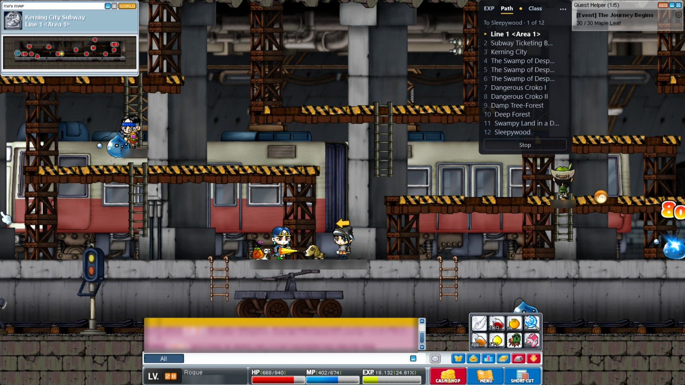

#  MapleLens

An open-source overlay for **MapleStory Classic** that keeps you in the game.
Instead of alt-tabbing to class guides, quest lists and route finders, MapleLens
reads what's on your screen and shows what you need on top of the game window.

**[Download for Windows or Mac](https://github.com/or-keren/maplelens/releases/latest)** ·
free and open source



## Screen-reading only

MapleLens only **looks at the screen**, the way you do. It takes pictures of the game
window and draws its own window on top. It never:

- reads or changes the game's memory, or hooks into the game in any way
- touches the game's files or its network traffic
- presses keys or clicks for you: no automation of any kind

## What it does

### Path arrow

Pick a map, and an arrow over your character points the way (above). Keep the game's
minimap open: the arrow is placed from it.

- The Path tab lists every map on the route there; tick **Use taxi** to ride the cabs.
- The arrow points to the next portal, and to the NPC when you're headed to one.
- Hidden portals get a hint: "stand on it and press ↑".

### EXP meter

Your EXP per hour and time to level, live.

- A first estimate from your second kill, marked **measuring** until there's a minute of play.
- Your session's average beside the last 5 minutes, across maps and levels.
- **History** keeps the average for every map you've trained on, with the best maps for
  your class and level at the top.
- **Pin** keeps the EXP line on every other tab. If the EXP bar can't be read, the tab says
  so in amber.


### Class helper

Where to train for your class and level, and what comes next.

- The guide's training spots for your level, your best one marked from your own EXP
  history; one click sets a route there.
- Hover a spot to see its map, where each monster spawns, and their level, HP and EXP.
- Pick your build; a Beginner picks the class they're heading for.
- Job advancement, gear, and where to put AP and SP, marked right on the game's stat and
  skill windows.


### Quest helper

Open a quest in the game, and the box switches to the Quests tab: where to go for each
NPC, monster and item it needs, one click to set a route there.

- Each quest's rewards: EXP, mesos, the items (the ones for your class) and what the rest
  of its chain pays.
- Track quests to keep them. Quests you follow in the game's Quest Helper are tracked by
  themselves, and their targets drop off as you finish them.
- Each quest switches between **Closest** (the nearest map) and **Best** (the most
  monsters).


### The box

Drag it anywhere, and drag its corner to make it wider. **•••** on the box opens its menu.
The tray icon (Windows) or the maple leaf in the menu bar (Mac) hides MapleLens and brings
it back; it keeps recording while hidden.

## Requirements

- Windows 10/11, or macOS with MapleStory Classic from Nexon's Mac launcher
- The game running **windowed or borderless** (windowed only on the Mac). True fullscreen hides overlay windows.
- On the Mac, MapleLens needs Screen Recording. Running from source, that is the app you start it from (Terminal, say).

## Download (Windows)

1. Open the [latest release](https://github.com/or-keren/maplelens/releases/latest) and
   download `MapleLens-Setup-X.Y.Z.exe` under **Assets**. If your browser says the file
   isn't commonly downloaded, choose to keep it.
2. Run it. The installer isn't signed yet, so Windows may show "Windows protected your
   PC". Click **More info**, then **Run anyway**. It installs for your user only and
   doesn't ask for admin rights.
3. Start MapleStory Classic **windowed or borderless**.
4. Start MapleLens from the Start menu (or leave "Launch MapleLens" ticked on the last
   setup page). It finds the game window by itself. If the box says "Looking for
   MapleStory…", click **•••** on the box, choose **Pick game window…** and pick the game.
5. Drag the box where you want it. History opens the per-map table.

**Tray icon:** while MapleLens runs, its icon sits in the taskbar's notification area
(or under its ^). Click it to hide MapleLens, and again to show it: it keeps recording
while hidden. Its menu is the same as **•••** on the box.

**Which version:** click **•••**, then **About MapleLens**. The box shows the version, whether
an update is out, and a link to the GitHub page. **×** brings the tabs back.

**Updating:** when a new version is out, the box says "Update to X.Y.Z: click •••".
Click **•••** on the box and choose **Update to X.Y.Z…**. MapleLens downloads the setup,
checks it against the SHA-256 checksum GitHub publishes for it, saves your session and
closes. Setup then installs the new version without asking anything and starts it again.
Your settings and EXP history are kept. You can also download the newer setup and run it
yourself. It installs over the old version, and if MapleLens is running, Setup offers to
close it.

**The update check talks to GitHub:** a few seconds after it starts and then once a day,
MapleLens sends one HTTPS request to GitHub's API for the latest release. The request
carries `MapleLens/<version>` as its User-Agent and nothing about you or the game; the
update itself is downloaded from GitHub too. To turn the check off, click **•••** on the box,
choose **Settings…** and untick **Check for updates automatically**. **Check now**, beside
it, still works when you want it. Only the installed app checks (Windows or Mac); running
from source never does.

**Settings:** click **•••** on the box and choose **Settings…**. Every change applies at
once. You can turn off a tool you don't use (its tab goes away; at least one stays on),
change the path arrow's size and colour, or hide it (under Path), and turn off the AP/SP
marks on the game's stat and skill windows (under Class).

**Uninstalling:** Settings → Apps → MapleLens. Your settings and history stay in
`%APPDATA%\MapleLens`; delete that folder to remove them too. If something goes wrong,
attach `%APPDATA%\MapleLens\maplelens.log` (MapleLens writes its errors there) to a bug
report.

## Download (Mac)

Apple silicon (M1 or newer) or Intel, on macOS 14.4 or newer.

1. Open the [latest release](https://github.com/or-keren/maplelens/releases/latest) and
   download your Mac's dmg under **Assets**: `MapleLens-X.Y.Z.dmg` for Apple silicon,
   `MapleLens-X.Y.Z-intel.dmg` for Intel. Not sure which you have? Apple menu → **About
   This Mac**: "Chip … Apple M…" is Apple silicon, "Processor … Intel" is Intel.
2. Open the dmg and drag **MapleLens** onto **Applications**.
3. Open MapleLens from Applications. It isn't notarized by Apple, so macOS refuses the
   first time. Open **System Settings → Privacy & Security**, scroll down and click
   **Open Anyway** next to MapleLens, then confirm. You only do this once.
4. MapleLens needs Screen Recording to see the game. If the box says "Allow, then
   reopen: click •••", click **•••** on the box, choose **Open Screen Recording
   settings…** and tick MapleLens. Then quit MapleLens (click its maple leaf in the
   menu bar at the top of the screen and choose **Quit MapleLens**) and open it from
   Applications again: macOS doesn't give a running app the permission, and it doesn't
   offer to restart it. If MapleLens is already switched on there but the box keeps
   asking (an older copy's permission), quit MapleLens, run
   `tccutil reset ScreenCapture io.github.or-keren.maplelens` in Terminal, then open
   MapleLens and allow it again.
5. Start MapleStory Classic **windowed** (the Mac launcher's fullscreen hides overlays),
   then use the box as on Windows. If it says "Looking for MapleStory…", click **•••** on
   the box and choose **Pick game window…**. MapleLens has no Dock icon: its maple leaf
   in the menu bar opens the same menu, and **Hide MapleLens** / **Show MapleLens** there
   hides the box and the arrow and brings them back.

**Updating:** same as Windows: click **•••** on the box and choose **Update to X.Y.Z…**.
MapleLens downloads the new dmg, checks its SHA-256 checksum, and swaps itself in. You
keep Screen Recording and don't see Open Anyway again. If the box says "Move to
Applications to update", drag MapleLens into Applications and open it from there. Rarely,
macOS blocks the swap and the box says "Allow updates: click •••"; then click **•••**,
choose **Allow MapleLens to update…** and accept the macOS prompt.

**Removing:** drag MapleLens from Applications to the Trash. Your settings and history stay
in `~/Library/Application Support/MapleLens`; delete that folder to remove them too. If
something goes wrong, attach `~/Library/Application Support/MapleLens/maplelens.log` to a
bug report.

## Coming next

**Prices:** market lookups without leaving the game.

## Run from source (macOS, developers)

You need [uv](https://docs.astral.sh/uv/). Start the game windowed or borderless, then:

```
git clone https://github.com/or-keren/maplelens.git
cd maplelens
uv sync
uv run maplelens
```

MapleLens looks for the window titled `MapleStory`. If yours is called something else,
click **•••** on the box and use **Pick game window…**. The choice is saved.

## Development

Run the tests with `uv run pytest`. See [CONTRIBUTING.md](CONTRIBUTING.md) for the
checks, the workflow and how releases are made.

The screen-reading-only rule is checked on every change by `scripts/check_screen_only.py`
in CI. That script is a speed bump against honest mistakes, not a security boundary. The
rule itself is what matters, and pull requests that break it are not accepted.

## Credits

> Map and portal data adapted from [meowdb](https://meowdb.com/msclassic).
> Minimap and map pictures, item icons, monster pictures and stats, and portal types from [OSMS Data Explorer](https://osmsdataexplorer.com) (CC BY 4.0).
> Quest data adapted from [meowdb](https://meowdb.com/msclassic) (NiaDB) and [OSMS Data Explorer](https://osmsdataexplorer.com) (CC BY 4.0).
>
> Class plans adapted from the NiaDB class guides:
>   [beginners-guide-first-steps-in-maple-world](https://meowdb.com/msclassic/guides/beginners-guide-first-steps-in-maple-world) ·
>   [warrior-class-guide](https://meowdb.com/msclassic/guides/warrior-class-guide) ·
>   [magician-class-guide](https://meowdb.com/msclassic/guides/magician-class-guide) ·
>   [bowman-class-guide](https://meowdb.com/msclassic/guides/bowman-class-guide) ·
>   [thief-class-guide](https://meowdb.com/msclassic/guides/thief-class-guide) ·
>   [fighter-class-guide](https://meowdb.com/msclassic/guides/fighter-class-guide) ·
>   [page-class-guide](https://meowdb.com/msclassic/guides/page-class-guide) ·
>   [spearman-class-guide](https://meowdb.com/msclassic/guides/spearman-class-guide) ·
>   [fp-wizard-class-guide](https://meowdb.com/msclassic/guides/fp-wizard-class-guide) ·
>   [il-wizard-class-guide](https://meowdb.com/msclassic/guides/il-wizard-class-guide) ·
>   [cleric-class-guide](https://meowdb.com/msclassic/guides/cleric-class-guide) ·
>   [hunter-class-guide](https://meowdb.com/msclassic/guides/hunter-class-guide) ·
>   [crossbowman-class-guide](https://meowdb.com/msclassic/guides/crossbowman-class-guide) ·
>   [assassin-class-guide](https://meowdb.com/msclassic/guides/assassin-class-guide) ·
>   [bandit-class-guide](https://meowdb.com/msclassic/guides/bandit-class-guide)

## Disclaimer

Unofficial fan project; not affiliated with Nexon. MapleStory is a trademark of
Nexon. Use at your own risk.

## License

[MIT](LICENSE)
